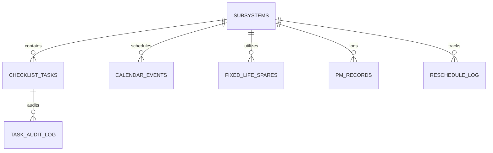

# 🛰️ Radar Preventive Maintenance (RPM) Dashboard & Industrial Asset Management System
## Final Technical & Operational Project Report

**Author:** Radar Maintenance Engineering Team  
**System Version:** 1.0.0 (Office-Ready Production Build)  
**Database Schema:** `maintanencedashboard` (MySQL 8.0)  
**Date:** October 2026  

---

## 1. Executive Summary

The **Radar Preventive Maintenance (RPM) Dashboard** is a military-grade, web-based industrial asset management application designed to track, schedule, and execute preventive maintenance protocols across complex radar subsystems. 

The system bridges frontline technical execution with supervisory compliance by recording every checklist tick and untick directly into an immutable audit trail in **MySQL Workbench**, enforcing role-based permissions, monitoring consumable inventory levels, and delivering instructional media guides (video and schematics) for every maintenance procedure.

---

## 2. Technical Stack & Architecture

```
┌────────────────────────────────────────────────────────────────────────┐
│                          PRESENTATION TIER                             │
│       React 19 • TypeScript • Vite • TanStack React Query 5            │
│         Tailwind / Modern Inter CSS • HTML5 Media Streaming            │
└──────────────────────────────────┬─────────────────────────────────────┘
                                   │ HTTP / JSON API Proxy (Port 5000)
┌──────────────────────────────────▼─────────────────────────────────────┐
│                          APPLICATION TIER                              │
│              Node.js 22 • Express 4.19 • Multer • PDFKit               │
│         SheetJS Ingestion • HTTP 206 Partial Content Streaming         │
└──────────────────────────────────┬─────────────────────────────────────┘
                                   │ mysql2 / Named Placeholders Pool
┌──────────────────────────────────▼─────────────────────────────────────┐
│                           DATA STORAGE TIER                            │
│           MySQL 8.0 Server (Database: maintanencedashboard)            │
│        10 Normalized Tables • Foreign Key Constraints • Audit Logs     │
└────────────────────────────────────────────────────────────────────────┘
```

| Layer | Component | Specification |
|-------|-----------|---------------|
| **Frontend** | React 19 + TypeScript | High-performance reactive UI with client caching via TanStack Query |
| **Backend** | Express + Node.js | REST API server with live connection pooling and audit insertion |
| **Database** | MySQL Server 8.0 | `maintanencedashboard` database with 10 tables and real-time audit logging |
| **Media Engine** | Multer + Express Static | Universal video (`.mp4`, `.webm`, `.mov`, `.mkv`) and image streaming |
| **Report Engine** | PDFKit | High-resolution PDF maintenance schedule generation |
| **Data Ingestion** | SheetJS (`xlsx`) | Master Excel synchronizer with tick preservation |

---

## 3. Database Schema Overview (10 Tables)

The underlying schema in MySQL Workbench (`maintanencedashboard`) is completely normalized and production-tested:



1. **`subsystems`**: 12 core radar subsystems (Liquid Cooling Unit, Rectifier, Transmitter, Antenna, etc.) with frequency color codes and estimated service durations.
2. **`checklist_tasks`**: 54 comprehensive inspection procedures detailing time, required special tools, PPE requirements, mandatory flags, and reference filenames.
3. **`task_audit_log`**: Real-time event log recording every task tick, untick, old status, new status, timestamp, and full user attribution (`TECH001 - Technician Alpha`).
4. **`consumables`**: 20 consumable materials (EP-2 Grease, coolant fluids, filters) with real-time stock counters, minimum alert thresholds, and low-stock indicators.
5. **`fixed_life_spares`**: 18 critical spare components with months remaining and automated alert levels (OK, Warning, Expired).
6. **`calendar_events`**: 30 maintenance milestones distributed across calendar dates with frequency codes (Weekly, Monthly, Quarterly, Annual).
7. **`users`**: 8 system accounts managing RBAC permissions (`ADMIN001`, `ENG001`, `TECH001`, `LOG001`, `SUP001`).
8. **`pm_records`**: Historical maintenance completion records and compliance percentages.
9. **`reschedule_log`**: Formal change records documenting rescheduled events, reasons, and approving authorities.
10. **`upload_log`**: Ledger tracking Excel spreadsheet ingestion timestamps and batch changes.

---

## 4. Key Functional Features Implemented

### Feature 1: Real-Time Checklist Tick/Untick & MySQL Audit Trail
- **Mechanism**: Ticking or unticking any checklist item triggers an immediate `PUT /api/checklist/:taskId/status` call.
- **Database Action**: Updates `checklist_tasks.completion_status` and immediately writes an entry into `task_audit_log` with the exact username, timestamp, and transition.
- **UI Feedback**: Dynamic completion progress bar (`X / 54 (Y%)`), visual strike-through styling, and an expandable **🕐 Audit Trail Drawer** on every card displaying chronological change history.

```sql
-- Query in MySQL Workbench to observe real-time ticks:
SELECT id, task_id, old_status, new_status, changed_by, changed_at 
FROM maintanencedashboard.task_audit_log 
ORDER BY changed_at DESC LIMIT 10;
```

---

### Feature 2: Role-Based Stock Adjustments (`+` / `−` Controls)
- **Controls**: Every consumable item row in the **System Inventory Monitor** features dedicated `+` and `−` adjustment buttons.
- **Automated Threshold Checks**: When stock falls at or below `alert_threshold`, the row immediately adopts a high-visibility orange warning style, increments the header low-stock counter, and flags gatekeeping warnings.
- **Role Enforcement**: Stock buttons are active exclusively for **Logistics Officers** (`LOG001`) and **Administrators** (`ADMIN001`). For other roles, buttons display an informative security tooltip.

---

### Feature 3: Universal Format Video & Media Procedure Guide
- **Universal Format Compatibility**: Because video formats vary across field units, the system natively supports:
  - **Video**: `.mp4`, `.webm`, `.mov`, `.mkv`, `.avi`, `.ogv`
  - **Images & Schematics**: `.jpg`, `.jpeg`, `.png`, `.webp`, `.svg`, `.pdf`
- **Streaming Pipeline**: Backend handles HTTP 206 Range Requests, allowing seeking and fast-forwarding in long training videos.
- **Media Modal Features**:
  - **Video Guide Tab**: Plays uploaded procedural videos or displays the animated Radar Technical Simulation canvas when media is awaiting office recordings.
  - **Technical Diagram Tab**: Shows wiring schematics, panel diagrams, or component blueprints.
  - **In-App Media Uploader**: Built-in upload interface allowing technicians and engineers to attach office video files directly to any task on the fly.

---

### Feature 4: Role-Based Access Control (RBAC) System
A dynamic user selector in the header bar allows testing and operating the dashboard under any official role:

| Role | User ID | Checklist Ticking | Stock Adjustments | Reschedule PM | Excel Ingest | PDF Export |
|------|---------|:-----------------:|:-----------------:|:-------------:|:------------:|:----------:|
| **Administrator** | `ADMIN001` | ✅ | ✅ | ✅ | ✅ | ✅ |
| **Engineer** | `ENG001` | ❌ | ❌ | ✅ | ❌ | ✅ |
| **Technician** | `TECH001` | ✅ | ❌ | ❌ | ❌ | ✅ |
| **Logistics** | `LOG001` | ❌ | ✅ | ❌ | ❌ | ✅ |
| **Supervisor** | `SUP001` | ❌ | ❌ | ✅ | ❌ | ✅ |

---

### Feature 5: Preventive Maintenance Calendar & Date-Clash Rescheduling
- **Interactive Calendar**: 7-column CSS grid mapping scheduled radar inspections with distinct color swatches (Blue = Weekly, Red = Monthly, Green = Quarterly, Brown = Annual).
- **Date-Clash Validation**: When requesting a reschedule via the **Reschedule PM** modal, the backend verifies that the target subsystem does not already have an event on the new date, rejecting clashes with code 409.

---

### Feature 6: Master Excel Ingestion with Status Preservation
- **Spreadsheet Processing**: Ingests `RPM_Dashboard_InputData_v10.xlsx` via SheetJS.
- **State Preservation**: Re-uploading an updated master spreadsheet updates metadata without wiping out existing checklist completion statuses or audit records.

---

### Feature 7: Automated PDF Maintenance Plan Generation
- **Daily Export**: Downloads a formal PDF maintenance schedule for the selected date.
- **Monthly Export**: Compiles an executive summary PDF of all subsystem events and check steps scheduled for that calendar month.

---

## 5. Visual Reference Guide & Screen Layouts

```
┌────────────────────────────────────────────────────────────────────────────────────────┐
│ 📡 Radar Preventive Maintenance Dashboard        [TECH001 Technician Alpha ▼] [Export]│
├────────────────────────────────────────────────────────────────────────────────────────┤
│ [KPI Cards: Planned Checks: 6 | Est. Hours: 8.5h | Subsystems: 2 | Status Gauge: 67%]  │
├────────────────────────────────────────────────────────────────────────────────────────┤
│ [Frequency Legend: 🟦 Weekly  🟥 Monthly  🟩 Quarterly  🟫 Annual]                     │
├──────────────────────────┬──────────────────────────┬──────────────────────────────────┤
│    CALENDAR VIEW         │   SUBSYSTEMS & STOCK     │        CHECKLIST TASKS           │
│                          │                          │                                  │
│  Sun Mon Tue Wed Thu Fri │  Subsystem Eligibility:  │  LCU-T01: Input Power Stability  │
│       1   2   3   4   5  │  • LCU Unit (Weekly)     │  [x] Complete   🎥 Guide   🕐    │
│   6   7  [8]  9  10  11  │  • Rectifier (Monthly)   │  ------------------------------  │
│  12  13  14  15  16  17  │                          │  LCU-T02: LED Status Check       │
│                          │  Inventory Monitor:      │  [ ] Pending    🎥 Guide   🕐    │
│  [Event: LCU Weekly]     │  • EP-2 Grease: [−] 12 [+]│  ------------------------------  │
│  [Event: REC Monthly]    │  • Coolant:     [−]  4 [+]│  LCU-T03: Fan Inspection        │
│                          │    ⚠️ Low Stock Alert    │  [ ] Pending    🎥 Guide   🕐    │
└──────────────────────────┴──────────────────────────┴──────────────────────────────────┘
```

---

## 6. Verification Queries in MySQL Workbench

To verify data persistence during field demonstrations or office reviews, run the following queries in MySQL Workbench under connection **RPM Office Connection**:

```sql
USE maintanencedashboard;

-- 1. View live audit trail of all checklist ticks and media uploads:
SELECT id, task_id, old_status, new_status, changed_by, changed_at 
FROM task_audit_log 
ORDER BY changed_at DESC 
LIMIT 20;

-- 2. Inspect real-time completion status of all checklist tasks:
SELECT subsystem_id, task_id, step_no, task_title, completion_status, video_ref_filename 
FROM checklist_tasks 
ORDER BY subsystem_id, step_no;

-- 3. Check inventory quantities and auto-calculated status:
SELECT item_id, consumable_item_name, current_qty, alert_threshold, status, last_replenished 
FROM consumables 
ORDER BY current_qty ASC;

-- 4. Check active personnel accounts and roles:
SELECT user_id, full_name, role, status, permissions 
FROM users;
```

---

## 7. Git & Deployment Guide

This project is configured as a clean monorepo workspace ready for pushing to a remote Git repository:

```bash
# 1. Clone repository
git clone <your-new-repo-url>
cd rpm-dashboard-frontend-main

# 2. Configure environment
cd rpm-dashboard-main
cp .env.example .env
# Verify credentials:
# DB_HOST=localhost, DB_PORT=3306, DB_USER=root, DB_PASSWORD=root123, DB_NAME=maintanencedashboard

# 3. Install dependencies
cd ..
npm run install:all

# 4. Start backend (Terminal 1)
npm run dev:backend

# 5. Start frontend (Terminal 2)
npm run dev:frontend
```

---

*Report prepared and validated for the Radar Preventive Maintenance Division.*
